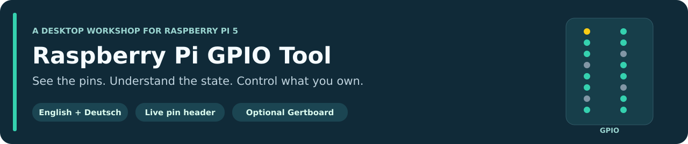
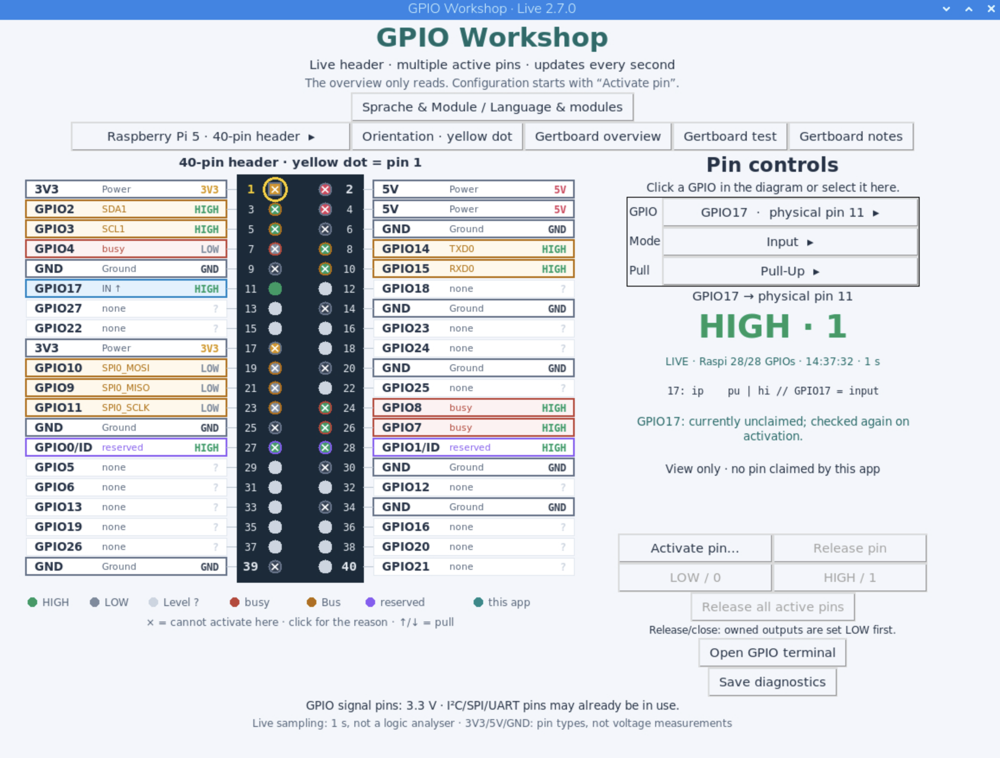
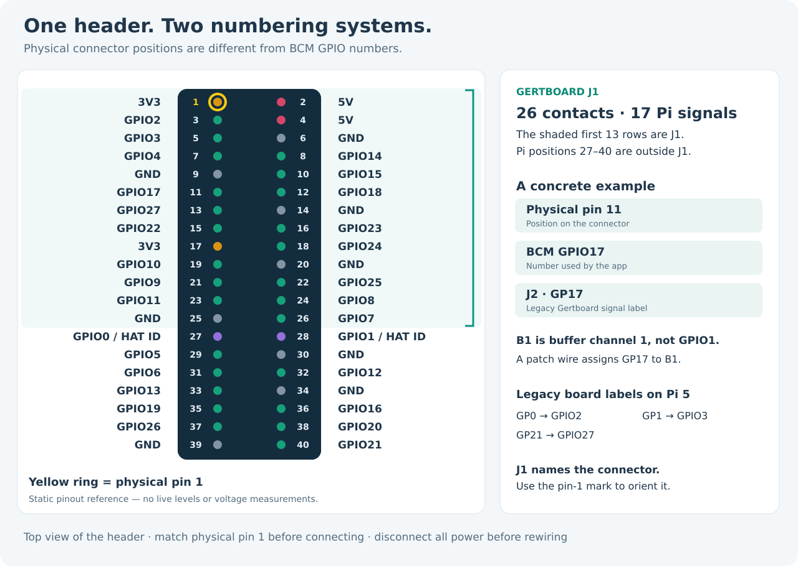
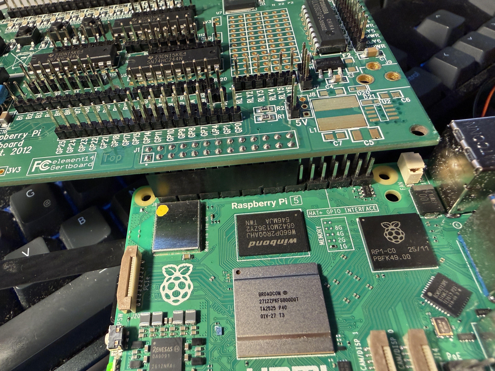

# Raspberry Pi GPIO Tool – Deutsch



[**Downloads**](https://github.com/LakeGriffin85/raspi-gpio-tool/releases/latest) ·
[**English**](README.md) · [**Gertboard**](docs/GERTBOARD.md) · [**Mitmachen**](CONTRIBUTING.md)

Eine grafische GPIO-Werkstatt für den **Raspberry Pi 5** mit Live-Steckerbild,
mehreren unabhängig aktiven Pins und einer Oberfläche auf Deutsch und Englisch.
Das Gertboard ist ein optionales Modul. [English README](README.md)

## Die Oberfläche



*Hier ist die englische Oberfläche zu sehen. Die Sprache lässt sich in der App
wechseln. Ein angezeigter HIGH-Pegel bedeutet noch nicht, dass die App den Pin aktiviert hat.*

## Installation

Voraussetzung: Raspberry Pi 5 mit grafischem Raspberry Pi OS auf Basis von
Debian Trixie und einer laufenden Desktop-Sitzung. Als normaler Benutzer:

```bash
git clone https://github.com/LakeGriffin85/raspi-gpio-tool.git
cd raspi-gpio-tool
bash install.sh
```

Mit zusätzlicher Gertboard-Übersicht:

```bash
bash install.sh --gertboard
```

Alternativ das passende Release-ZIP entpacken und dessen `install.sh` auf dem Pi
mit bash starten. Beide Pakete enthalten Deutsch und Englisch. Die Basisversion
enthält das Atlasmodul nicht; die Gertboard-Version enthält es und bietet es unter
„Sprache & Module“ zur Auswahl an.

Die Einrichtung installiert Betriebssystempakete, liest Controller und Belegung
und sichert vorhandene App-Dateien. Sie aktiviert keinen Pin. Vor einem Update die
Werkstatt schließen. Danach „Raspberry Pi GPIO Tool“ über Desktop oder Menü öffnen.
Die öffentliche App nutzt normalerweise `~/.local/share/raspi-gpio-tool`; frühere
persönliche Desktop-Starter werden nicht ersetzt. Benutzername und Heimverzeichnis
werden bei der Installation ermittelt, nicht vorausgesetzt.

## Bedienung

- Die Übersicht liest einmal pro Sekunde. Auswählen und Hilfen öffnen schalten nichts.
- Erst „Pin aktivieren“ fordert einen freien GPIO an und konfiguriert ihn.
- Ein Ausgang startet LOW. Eigene Ausgänge werden vor Freigabe/Schließen LOW gesetzt.
- Mehrere Pins können aktiv bleiben; zwischen ihnen darf gewechselt werden.
- Belegte Leitungen, aktive Busfunktionen und GPIO0/1 für HAT-Erkennung bleiben geschützt.
- Auswahlfelder mit ▸ öffnen normale Fenster. Übernehmen/Enter/Doppelklick bestätigt;
  Abbrechen/Escape verwirft. Eine offene Auswahl hält die Live-Uhr nicht an.

Über „Sprache & Module / Language & modules“ lassen sich Deutsch/Englisch und die
Gertboard-Funktionen wählen. Zuerst alle aktiven Pins freigeben. Die Oberfläche
öffnet sich danach neu; Einstellungen bleiben unter
`~/.config/raspi-gpio-tool/settings.json` erhalten (XDG_CONFIG_HOME wird beachtet).
Ohne das optionale Atlasmodul bleibt die GPIO-Grundansicht nutzbar.

Das Gertboard-Modul zeigt J1-Pins 1–26, 17 Pi-Signale, 24 Boardbereiche und
LED-/Tasteranleitungen. [Gertboard-Details](docs/GERTBOARD.md)

## Orientierung und Aufbau



Der gelbe Punkt markiert **physischen Pin 1**. „J1“ bezeichnet den ganzen Stecker;
die Position dieses Aufdrucks ist keine Pin-1-Markierung.

<p align="center">
  
</p>

*Freigegebenes Referenzfoto aus dem Projekt, ohne identifizierende Metadaten.
Es zeigt die mechanische Anordnung und ist kein vollständiger Verdrahtungsplan.*
Die [Gertboard-Anleitung](docs/GERTBOARD.md) enthält zusätzlich eine schematische
Übersicht der Funktionsbereiche.

## Mitmachen

Alle können das öffentliche Projekt herunterladen oder forken. Änderungen lassen
sich in einem eigenen Fork committen und per Pull Request vorschlagen. Direkt in
dieses Repository schreiben können nur Personen mit erteiltem Schreibrecht.
Der kurze Ablauf steht in [CONTRIBUTING.md](CONTRIBUTING.md).

[Verhaltensregeln](CODE_OF_CONDUCT.md) · [Sicherheitsmeldungen](SECURITY.md) ·
[Barrierefreiheit und bekannte Grenzen](ACCESSIBILITY.md)

## Grenzen

GPIO-Logik arbeitet mit 3,3 V. GPIOs messen digitale Pegel, keine analogen Spannungen.
Die Ein-Sekunden-Ansicht ist kein Logikanalysator oder Frequenzzähler. Versorgung
und GND sind feste Pin-Typen, keine gemessenen Spannungen. Physische Pin-Nummern,
BCM-GPIO-Nummern und Buffer-Kanäle sind unterschiedliche Bezeichnungen.
Vor dem Umstecken herunterfahren und alle Speisungen trennen.

Tests und Paketbau sind in der englischen README beschrieben. Die nativen Tests
benötigen einen Desktop und verwenden wie die anderen Tests nur simulierte Pins.
Lokale Diagnoseprotokolle vor dem Teilen auf persönliche Angaben prüfen.
Lizenz: [MIT](LICENSE).
